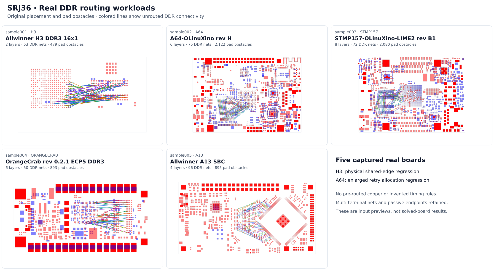

# dataset-srj36-real-ddr

Five captured routing inputs from real CPU/FPGA + DDR3 boards. These preserve the
placement, pad obstacles, signal nets, passive endpoints, layer restrictions and
routing rules used to investigate the A64/H3 DDR memory problems in
[autorouter #3331](https://github.com/tscircuit/tscircuit-autorouter/pull/3331) and
[#3332](https://github.com/tscircuit/tscircuit-autorouter/pull/3332).



The screenshot shows **unrouted inputs**, with straight ratsnest lines between
signal endpoints. It does not show completed routing or DDR timing validation.
Individual SVG and PNG previews are in [previews/](previews/).

| Sample | Board | Layers | DDR nets | Terminals | Pad obstacles |
| --- | --- | ---: | ---: | ---: | ---: |
| [001](samples/sample001.json) | Allwinner H3 DDR3 16x1 | 2 | 53 | 108 | 479 |
| [002](samples/sample002.json) | OLIMEX A64-OLinuXino rev H | 6 | 75 | 184 | 2,122 |
| [003](samples/sample003.json) | OLIMEX STMP157-OLinuXino-LIME2 rev B1 | 8 | 72 | 201 | 2,080 |
| [004](samples/sample004.json) | OrangeCrab rev 0.2.1 ECP5 DDR3 | 6 | 50 | 102 | 893 |
| [005](samples/sample005.json) | Allwinner A13 SBC | 4 | 96 | 192 | 895 |

## Install and use

Follow the [dataset conventions](https://github.com/tscircuit/handbook/blob/main/guides/dataset-guidelines.md):
plain `index.js`, lightweight `index.d.ts`, checked-in JSON, no transpilation and
no npm publication. Install from GitHub; pin a commit for reproducible comparisons.

```sh
bun add https://github.com/ShiboSoftwareDev/dataset-srj36-real-ddr
```

```js
import { dataset, sample002 } from "@tscircuit/dataset-srj36-real-ddr"
console.log(Object.keys(dataset), sample002.layerCount)
```

## Benchmark scope

The autorouter integration registers these as `36` / `srj36`, using Pipeline 9.
The first two samples retain the board contexts that exposed the memory bugs;
the remaining three provide related real DDR workloads. Inputs are not filtered
to boards known to finish routing.

```sh
# In the autorouter checkout after SRJ36 integration:
./benchmark.sh --pipeline 9 --dataset 36 --concurrency 1 --effort 1 \
  --sample-timeout 360s --max-rss-mib 12288
```

Compare the same inputs and routing rules on baseline and fixed revisions, one
board at a time. Record per-board peak RSS, time, stage reached, completion and
DRC. Record high-density stage measurements separately from complete-board routing.
Passing high-density routing does not establish complete-board DRC or DDR timing.
The historical A64 stage comparison was still 8.59 GiB after the fix.

The measurement-enabled branches in #3331/#3332 poll Linux process peak RSS from
the benchmark parent, so a busy routing loop cannot block memory accounting.
Their raw results retain elapsed time and cumulative RSS through the first
observed high-density completion in `highDensityStage`. The optional
`--max-rss-mib` limit fails over-budget samples and never counts a limit stop as
solved. Both sides of a comparison must use this same measurement code.

Older single-thread benchmark revisions can report stale startup RSS after a
timeout because their progress timer is blocked by synchronous routing. Those
timeout values must not be used to measure the DDR improvement.

## Measured baseline and fix

[Same-machine Blacksmith run](https://github.com/tscircuit/tscircuit-autorouter/actions/runs/40762425047),
2026-10-28: baseline `df79cbbb579b5a4c87977e6020dd93335df1a7f8` followed by the
stacked fix `dce0868770955001c30815c8ab1d49284f5f37fa`, both using dataset commit
`f5e1d6886ee74f136a627e0e4f92aafbf3375154`. Pipeline 9, Bun 1.4.2, Linux ARM64,
8 vCPUs, one routing thread and one sample at a time, effort 1, 360 seconds and
12 GiB maximum RSS per sample. The two revisions use identical measurement code;
the baseline's production solver source matches main at `637b6c58`.

| Sample | Baseline peak MiB | Fixed peak MiB | Observed change | Full-run seconds, baseline → fixed | Outcome on both |
| --- | ---: | ---: | ---: | ---: | --- |
| H3 (001) | 7,185.1 | 1,700.9 | -76.3% | 360.0 → 360.0 | Timeout |
| A64 (002) | 10,481.4 | 9,170.3 | -12.5% | 360.0 → 360.0 | Timeout |
| STM32MP157 (003) | 7,860.0 | 8,190.0 | +4.2% | 360.0 → 360.0 | Timeout |
| OrangeCrab (004) | 2,246.1 | 2,175.7 | -3.1% | 129.5 → 121.7 | Completed; DRC failed |
| A13 (005) | 4,655.8 | 4,420.4 | -5.1% | 292.0 → 314.9 | Completed; DRC failed |

H3 provides the clearest evidence: the baseline times out in high-density routing
at 64% observed stage progress, while the fix completes that stage in 143.4 seconds
with a cumulative peak of 1,700.2 MiB. The fixed full board still times out in
`highDensityForceImproveSolver`. A64 remains memory-heavy and both revisions time
out in high-density routing at 42% observed progress. STM32MP157 also times out
there, at 34% baseline / 44% fixed progress.

High-density stage completion rises from 2/5 to 3/5, but full-board completion
remains 2/5 and relaxed DRC passes remain 0/5. Both revisions report the same 157
DRC issues across OrangeCrab and A13. No sample hits the RSS cap. Observed median
peak RSS falls 38.5%, from 7,185.1 to 4,420.4 MiB; the timed-out workloads have not
completed equal work, so this is not a completed-board memory saving estimate.
This is one ordered run, without repeated-run variance estimates. DDR timing is
not validated. A13 takes 7.8% longer despite its lower peak RSS.

[Recorded measurements and input hashes](benchmarks/2026-10-28-srj36.json),
[job-log evidence](benchmarks/2026-10-28-srj36-log.txt), and the
[benchmark summary and raw-report artifact](https://github.com/tscircuit/tscircuit-autorouter/pull/3332#issuecomment-6479730727)
retain the comparison. Per-board values here are transcribed from job logs at
their printed precision (0.1 seconds / 0.1 MiB); full-precision JSON reports are
in the workflow artifact.

The exact local checkpoints and commands are documented in [repro/README.md](repro/README.md).

## Extraction and integrity

Each sample is byte-identical to its captured DDR-assessment input. The manifest
records its SHA-256; each [provenance file](provenance/) identifies the upstream
repository, immutable source commit/path/hash, chip references and transformations.

All named DDR signal nets incident to the selected CPU/FPGA or RAM are retained,
including multi-terminal nets and passive endpoints. Power, VREF, ZQ and
unconnected nets are excluded. Existing traces, vias and zones are removed.
There is no artificial widening, layer-count increase, or reduction to 16 nets.

Board edges use a bounding rectangle. Roundrect, oval and custom pad shapes use
the recorded rectangular approximations. Native KiCad pad primitives remain
separate obstacles, so an obstacle count is not necessarily a physical ball count.
Global clearance uses the maximum selected-net clearance; via dimensions use
existing DDR copper where available. The bus preserves allowed signal layers;
no timing, skew, impedance or differential-pair constraints are invented.

```sh
node scripts/validate.mjs       # no dependencies required; Node 22+ / Bun
bun install                    # development dependencies for preview rendering
bun run snapshots
python3 scripts/fetch-sources.py
python3 scripts/extract-kicad.py # checks regenerated inputs against captured hashes
```

Source licensing is recorded per sample in [LICENSE](LICENSE) and the provenance
files. Upstream notices are preserved in [licenses/](licenses/).
